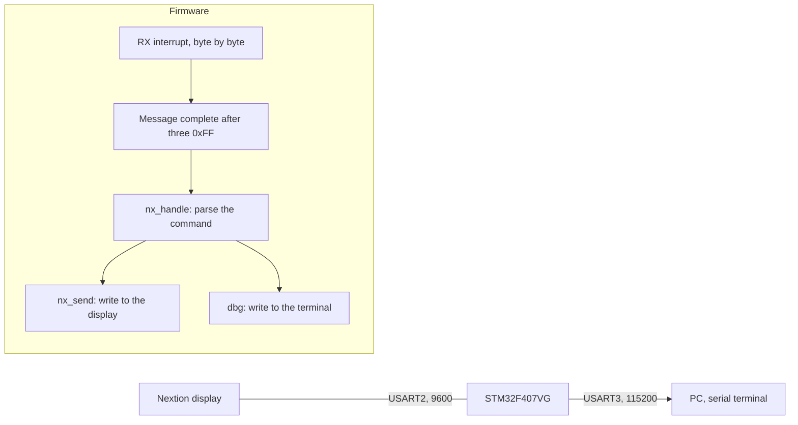

# Nextion HMI UART protocol for STM32

STM32F407 · message framing · command parser · debug log

   [](https://tech-ohm.com)

**English** | [Türkçe](README.tr.md) · An open-source project by [TECH-OHM](https://tech-ohm.com)

Firmware that exercises the UART protocol between a Nextion touch display and an STM32. I wrote it to verify the screen I designed for a packaging machine panel on its own, before any sensor or motor was connected. Every command from the display is parsed, answered on the display where needed, and logged to a PC over a second serial port.

The parts that are useful to anyone working with Nextion are the message framing and the command parser. The keypad, preset and counter logic is specific to this project.

## Block diagram



## Pins

| MCU pin | Connects to | Notes |
|---|---|---|
| PA2 | Nextion RX | USART2 TX, 9600 |
| PA3 | Nextion TX | USART2 RX |
| PB10 | USB-TTL RX | USART3 TX, 115200, log output |
| PB11 | USB-TTL TX | USART3 RX |
| GND | both grounds | common ground |

Power the display from a separate supply, not from the board's 5 V pin. A 7 inch display draws more at startup than the board can deliver.

## Message framing

Nextion ends every message with three `0xFF` bytes, in both directions.

MCU to display: the command text followed by `FF FF FF`.

```
n0.val=142 FF FF FF
```

Display to MCU: with `print "BF:1"` and `printh FF FF FF` on the Nextion side, these bytes arrive:

```
42 46 3A 31 FF FF FF
```

Reception works byte by byte in an interrupt. Three `0xFF` in a row mark the end of a message, which is then handed to the main loop. No parsing happens inside the interrupt. A new message does not overwrite one that has not been processed yet, and the buffer resets if it overflows.

At startup the firmware sends `bkcmd=0`. This turns off the acknowledge and error bytes Nextion returns after every command, so only my own messages reach the receiver.

## Commands from the display

| Command | Meaning | What the MCU does |
|---|---|---|
| `HOME` | home page opened | writes time, ambient temperature, active values and counters |
| `SETOPEN` | settings page opened | writes the values of both presets |
| `REPOPEN` | report page opened | writes date and time |
| `KPOPEN:n` | keypad opened, n selects the field | writes the title and the allowed range |
| `K:0` to `K:9` | digit key | updates the entered value on screen |
| `K:B`, `K:C`, `K:E` | backspace, cancel, confirm | range check on confirm |
| `MTYP:0`, `MTYP:1` | material type selected | loads that preset into the active values, a second press deselects |
| `BF:1`, `BF:0` | belt forward pressed, released | on press the counter of the selected type goes up by one |
| `BB:1`, `BB:0` | belt reverse pressed, released | logged only |
| `KB:x`, `KBDEL`, `KBCLR`, `KBOK` | text keyboard | updates the entered text on screen |
| `SKT:n`, `LANG:n`, `PRN:n`, `FNT:n` | various options | logged only |

A keypad value outside its range is rejected and the range text turns red: temperature 50 to 250, force 0 to 200, belt speed 7 to 15.

## Objects written on the display

| Object | Content |
|---|---|
| `n0`, `n1`, `n_spd` | active temperature, force, speed |
| `n_pos`, `n_tot` | counter of the selected type, total counter |
| `t_dt`, `t_amb` | date and time, ambient temperature |
| `t_title`, `t_val`, `t_range` | keypad title, entered value, range text |
| `t_m_*`, `t_t_*` | values of the two presets |
| `bt_med`, `bt_tyv` | material type buttons |

Time and ambient temperature are not real. They change every two seconds, five times, so you can see the fields update.

## Adapting it to your own screen

The Nextion `.HMI` file is not in this repository. On your own screen, add `print "COMMAND"` and `printh FF FF FF` to the touch events and change the comparisons in `nx_handle()` to your commands. `nx_send()`, `dbg()` and the receive interrupt can be used as they are.

The log text and some identifiers in the code are in Turkish.

## Build

In STM32CubeIDE use `File > Import > Existing Projects into Workspace` and select this folder.

## License

MIT. The STM32 HAL and CMSIS files under `Drivers` keep their own licenses.

## Author

M. Eyüb Can, embedded systems engineer and founder of [TECH-OHM](https://tech-ohm.com)

## About TECH-OHM

[TECH-OHM](https://tech-ohm.com) designs electronic boards and embedded software, from the first schematic to series production. We also run a 12-month embedded systems training program and consult for engineering teams.

Web: [tech-ohm.com](https://tech-ohm.com) · Email: info@tech-ohm.com
