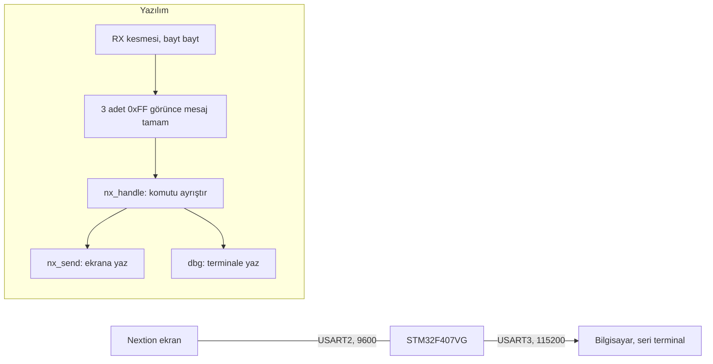

# STM32F407 ile Nextion ekran haberleşmesi

[English](README.md) | **Türkçe**

> [TECH-OHM](https://tech-ohm.com) açık kaynak projesi

Nextion dokunmatik ekranla STM32 arasındaki UART protokolünü deneyen yazılım. Bir paketleme makinesinin paneli için hazırladığım ekranı, sensör ve motor bağlamadan önce tek başına doğrulamak için yazdım. Ekrandan gelen her komut ayrıştırılıyor, gerekiyorsa ekrana cevap yazılıyor ve hepsi ikinci bir seri porttan bilgisayara loglanıyor.

Nextion ile çalışan herkesin işine yarayacak kısım mesaj çerçeveleme ve komut ayrıştırma. Tuş takımı, ayar seti ve sayaç mantığı bu projeye özel.

## Blok diyagram



## Pinler

| Kart pini | Bağlandığı yer | Açıklama |
|---|---|---|
| PA2 | Nextion RX | USART2 TX, 9600 |
| PA3 | Nextion TX | USART2 RX |
| PB10 | USB-TTL RX | USART3 TX, 115200, log çıkışı |
| PB11 | USB-TTL TX | USART3 RX |
| GND | ikisinin de GND ucu | ortak toprak |

Ekranı kartın 5 V pininden değil ayrı bir kaynaktan besle. 7 inç ekran açılışta kartın verebileceğinden fazla akım çekiyor.

## Mesaj çerçevesi

Nextion her iki yönde de mesajın sonuna üç tane `0xFF` koyuyor.

İşlemciden ekrana: komut metni ve ardından `FF FF FF`.

```
n0.val=142 FF FF FF
```

Ekrandan işlemciye: Nextion tarafında `print "BF:1"` ve `printh FF FF FF` yazılınca gelen baytlar:

```
42 46 3A 31 FF FF FF
```

Alma tarafı kesmeyle bayt bayt çalışıyor. Art arda üç `0xFF` gelince mesaj tamamlanmış sayılıp ana döngüye devrediliyor. Kesme içinde ayrıştırma yapılmıyor. Önceki mesaj daha işlenmediyse yenisi üzerine yazılmıyor, tampon dolarsa sıfırlanıyor.

Açılışta ekrana `bkcmd=0` gönderiliyor. Bu, Nextion'ın her komuttan sonra döndürdüğü onay ve hata baytlarını kapatıyor, böylece alma tarafına sadece kendi yazdığım mesajlar geliyor.

## Ekrandan gelen komutlar

| Komut | Anlamı | İşlemcinin yaptığı |
|---|---|---|
| `HOME` | ana sayfa açıldı | saat, ortam sıcaklığı, aktif değerler ve sayaçlar ekrana yazılır |
| `SETOPEN` | ayarlar sayfası açıldı | iki ayar setinin değerleri yazılır |
| `REPOPEN` | rapor sayfası açıldı | tarih ve saat yazılır |
| `KPOPEN:n` | tuş takımı açıldı, n hangi alan için | başlık ve izin verilen aralık yazılır |
| `K:0` ile `K:9` | rakam tuşu | girilen değer ekranda güncellenir |
| `K:B`, `K:C`, `K:E` | sil, iptal, onay | onayda aralık kontrolü yapılır |
| `MTYP:0`, `MTYP:1` | malzeme tipi seçimi | o tipin ayar seti aktif değerlere yüklenir, tekrar basılırsa seçim kalkar |
| `BF:1`, `BF:0` | bant ileri basıldı, bırakıldı | basışta seçili tipin sayacı bir artar |
| `BB:1`, `BB:0` | bant geri basıldı, bırakıldı | sadece loglanır |
| `KB:x`, `KBDEL`, `KBCLR`, `KBOK` | harfli klavye | girilen metin ekranda güncellenir |
| `SKT:n`, `LANG:n`, `PRN:n`, `FNT:n` | çeşitli seçenekler | sadece loglanır |

Tuş takımından girilen değer aralık dışındaysa kabul edilmiyor ve aralık yazısı kırmızıya çevriliyor: sıcaklık 50 ile 250, kuvvet 0 ile 200, bant hızı 7 ile 15.

## Ekrana yazılan nesneler

| Nesne | İçerik |
|---|---|
| `n0`, `n1`, `n_spd` | aktif sıcaklık, kuvvet, hız |
| `n_pos`, `n_tot` | seçili tipin sayacı, toplam sayaç |
| `t_dt`, `t_amb` | tarih ve saat, ortam sıcaklığı |
| `t_title`, `t_val`, `t_range` | tuş takımı başlığı, girilen değer, aralık yazısı |
| `t_m_*`, `t_t_*` | iki ayar setinin değerleri |
| `bt_med`, `bt_tyv` | malzeme tipi düğmeleri |

Saat ve ortam sıcaklığı gerçek değil. Ekrandaki alanların güncellendiğini görmek için iki saniyede bir, beş kez değişip duruyor.

## Kendi ekranına uyarlama

Nextion tarafındaki `.HMI` dosyası bu depoda yok. Kendi ekranında dokunma olaylarına `print "KOMUT"` ve `printh FF FF FF` satırlarını ekleyip `nx_handle()` içindeki karşılaştırmaları kendi komutlarına göre değiştirmen yeterli. `nx_send()`, `dbg()` ve alma kesmesi olduğu gibi kullanılabilir.

## Derleme

STM32CubeIDE'de `File > Import > Existing Projects into Workspace` ile klasörü seç.

## Lisans

MIT. `Drivers` klasöründeki STM32 HAL ve CMSIS dosyaları kendi lisanslarıyla gelir.

## Yazar

Gömülü Sistem Mühendisi M. Eyüb Can, [TECH-OHM](https://tech-ohm.com) kurucusu

## TECH-OHM

[TECH-OHM](https://tech-ohm.com) elektronik kart ve gömülü yazılım tasarlayan bir mühendislik firması. Fikirden seri üretime kadar tasarım işi alıyor, TECH-OHM Akademi'de 12 aylık gömülü sistem eğitimi ve şirketlere özel danışmanlık veriyor.

Web: [tech-ohm.com](https://tech-ohm.com) · E-posta: info@tech-ohm.com
